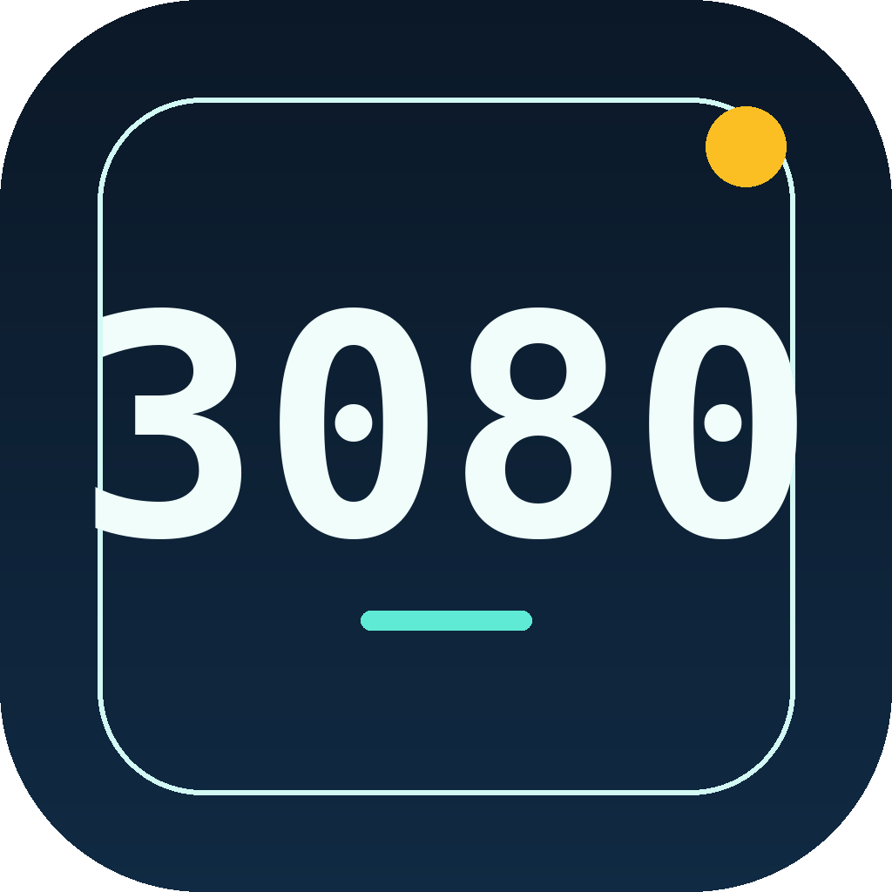
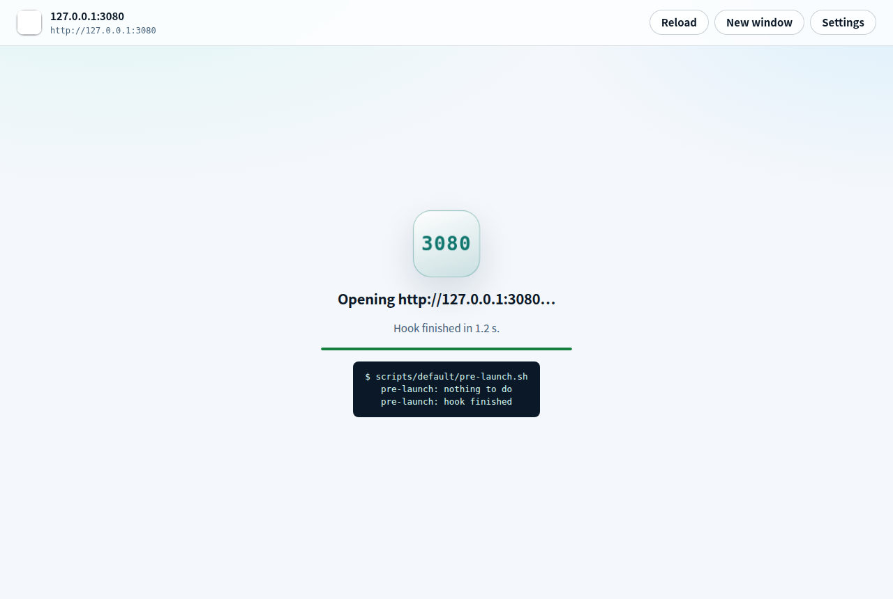
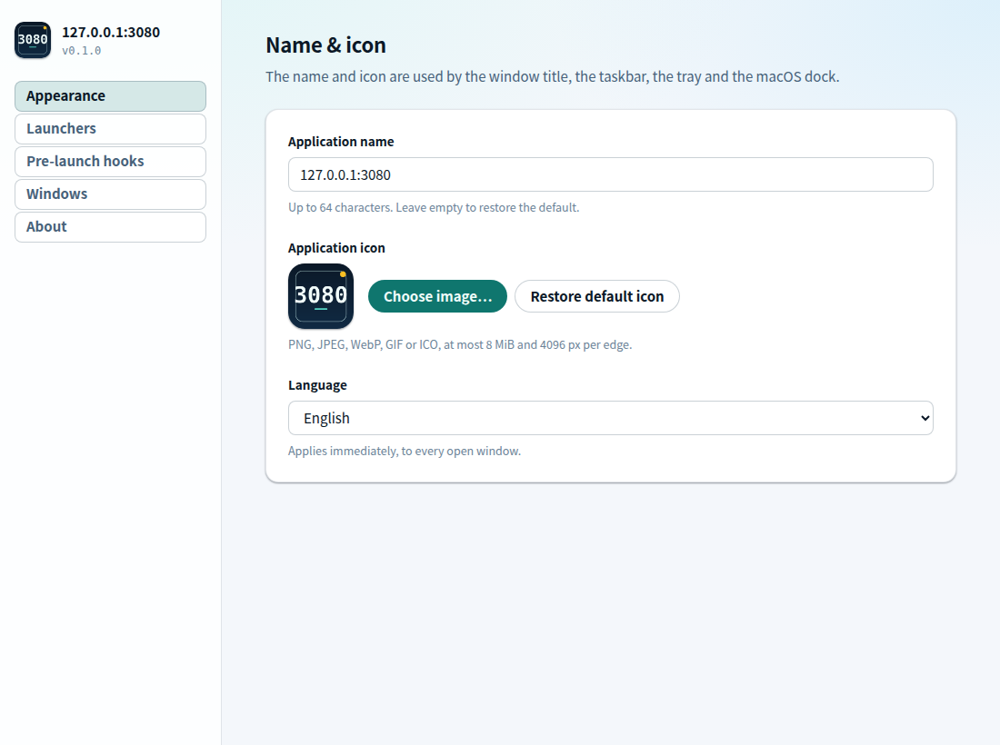

<div align="center">



# tauri-3080

**A tiny native window for `127.0.0.1:3080`.**

Open the app, and it opens your local service. That is the whole idea.
Run a pre-launch hook first if you need to, keep several launchers around,
rename the app and give it your own icon.

[](https://github.com/Iamliuxiaozhen/tauri-3080/actions/workflows/ci.yml)
[](https://github.com/Iamliuxiaozhen/tauri-3080/actions/workflows/smoke.yml)
[](https://github.com/Iamliuxiaozhen/tauri-3080/releases)
[](LICENSE)

Linux · macOS · Windows · English · 简体中文 · 繁體中文 · Português (Brasil)

</div>

---

<div align="center">
  
  
</div>

---

## Why

A local web UI is great until you have to keep a browser tab for it. This app
gives `127.0.0.1:3080` a proper window, a taskbar entry, a tray icon and a
name — and it can start whatever needs to be running on that port before the
page loads.

- **One job, done well.** The default profile opens `http://127.0.0.1:3080`.
- **Pre-launch hooks.** A script in `~/.config/tauri-3080/scripts/<profile>/`
  runs _before_ the page loads, with a timeout and live output.
- **Multiple windows.** Every window is independent: its own profile, its own
  hook run, its own process.
- **Make it yours.** Rename the application and replace its icon from the
  settings page — window title, taskbar, tray and dock all follow.
- **Hand-editable configuration.** Everything lives in one commented
  `config.toml`; the UI never destroys your comments.
- **Four languages.** English, Simplified Chinese, Traditional Chinese and
  Brazilian Portuguese, switchable at runtime.

## Features

|                     |                                                                                                                       |
| ------------------- | --------------------------------------------------------------------------------------------------------------------- |
| **Profiles**        | Any number of launchers, each with a URL, a name and a hook.                                                          |
| **Pre-launch hook** | `sh` on Unix, PowerShell/cmd on Windows. Streamed output, hard timeout, optional wait-for-port.                       |
| **Multi-window**    | Open as many launcher windows as you like; new windows inherit the profile you pick.                                  |
| **Rename + icon**   | Application name and PNG/JPEG/WebP/GIF/ICO icon, applied to windows, tray and dock.                                   |
| **i18n**            | English, 简体中文, 繁體中文, Português (Brasil) — the catalogues are tested for completeness.                         |
| **Tray & menu**     | Native menu bar and tray entry with the profile list.                                                                 |
| **Safe by default** | Path traversal is rejected, scripts stay inside the config directory, no `asset:` protocol, explicit capability list. |

## Install

Download the installer for your platform from
[Releases](https://github.com/Iamliuxiaozhen/tauri-3080/releases):

| Platform | Artifact                         |
| -------- | -------------------------------- |
| Linux    | `.deb`, `.rpm`, `.AppImage`      |
| macOS    | `.dmg` (Apple silicon and Intel) |
| Windows  | `.msi`, `.exe` (NSIS)            |

Releases are published **as drafts** by default: a maintainer reviews the
generated notes and published artifacts before they go live.

### Build from source

Requirements: Node.js 22+, Rust 1.77.2+, and the
[Tauri prerequisites](https://v2.tauri.app/start/prerequisites/) for your OS.

```bash
git clone https://github.com/Iamliuxiaozhen/tauri-3080.git
cd tauri-3080
npm ci
npm run tauri:dev      # development, with hot reload
npm run tauri:build    # installers under src-tauri/target/release/bundle
```

## Configuration

Everything the launcher owns lives in one directory:

| Platform | Directory                                                      |
| -------- | -------------------------------------------------------------- |
| Linux    | `$XDG_CONFIG_HOME/tauri-3080` (usually `~/.config/tauri-3080`) |
| macOS    | `~/Library/Application Support/tauri-3080`                     |
| Windows  | `%APPDATA%\tauri-3080`                                         |

```text
tauri-3080/
├── config.toml          # settings + profiles, safe to edit by hand
├── icons/               # custom application and profile icons
├── logs/                # one log per hook run
├── profiles/            # reserved for future per-profile documents
└── scripts/
    └── default/
        └── pre-launch.sh
```

### `config.toml`

```toml
[settings]
locale = "en"                    # "en" | "zh-CN" | "zh-TW" | "pt-BR"
display_name = "127.0.0.1:3080"  # shown in the title bar, tray and dock
icon_path = "app-icon.png"       # file inside ./icons
default_profile = "default"
close_to_tray = false

[settings.window]
width = 1280
height = 860

[profile.default]
id = "default"
name = "127.0.0.1:3080"
url = "http://127.0.0.1:3080"
prelaunch = "run"                # "run" | "wait-for-port" | "skip"
timeout_secs = 30
wait_timeout_secs = 60
kill_previous = true
```

Unknown keys are preserved across saves, so it is safe to keep your own notes
and future options in the file.

### Pre-launch hooks

The hook runs from `scripts/<profile-id>/` **before** the window navigates.

```bash
#!/usr/bin/env sh
# scripts/default/pre-launch.sh

if ! curl -fsS http://127.0.0.1:3080/health >/dev/null 2>&1; then
  nohup my-service --port 3080 >>"$TAURI_3080_CONFIG_DIR/logs/service.log" 2>&1 &
fi
```

| Mode            | Behaviour                                                                               |
| --------------- | --------------------------------------------------------------------------------------- |
| `run`           | Run the hook, then open the window.                                                     |
| `wait-for-port` | Run the hook, then wait until the URL accepts TCP connections (or `wait_timeout_secs`). |
| `skip`          | Never run the hook.                                                                     |

The script receives:

| Variable                | Meaning                                       |
| ----------------------- | --------------------------------------------- |
| `TAURI_3080_PROFILE`    | Profile identifier.                           |
| `TAURI_3080_URL`        | URL the window will open.                     |
| `TAURI_3080_CONFIG_DIR` | Absolute path of the configuration directory. |

Hook output is streamed into the launcher window and written to
`logs/prelaunch-<profile>.log`. A non-zero exit code keeps the window on the
progress screen and offers to open the URL anyway.

> **Security note.** Hooks are arbitrary local scripts. Anything that can write
> to `~/.config/tauri-3080/scripts` can execute code with your user account. Keep
> the directory private (`chmod 700`) on shared machines.

## Keyboard shortcuts

| Shortcut           | Action                     |
| ------------------ | -------------------------- |
| `Ctrl`/`Cmd` + `N` | New window                 |
| `Ctrl`/`Cmd` + `,` | Settings                   |
| `Ctrl`/`Cmd` + `R` | Re-run the hook and reload |
| `Ctrl`/`Cmd` + `Q` | Quit                       |

## Architecture

```text
src/                    # web frontend (Vite + TypeScript, no framework)
├── launcher/           # progress screen → navigates to the profile URL
├── settings/           # appearance, profiles, hooks, windows, about
├── i18n/               # en / zh-CN / zh-TW / pt-BR catalogues
└── lib/                # IPC bridge, launch state machine, DOM helpers

src-tauri/src/          # Rust backend
├── commands.rs         # IPC surface
├── config.rs           # config.toml (toml_edit, comment preserving)
├── prelaunch.rs        # script discovery, execution, timeout, wait-for-port
├── state.rs            # shared state, atomic writes
├── windows.rs          # window factory (multiple launcher windows)
├── menus.rs            # native menu + tray
├── icons.rs            # icon import, decoding, resizing
├── i18n.rs             # native chrome translations
└── platform_info.rs    # dock icon (macOS), taskbar icon (Windows)
```

The window first loads the bundled page, runs the hook there and only then
navigates to the profile URL — so a slow hook shows progress instead of a
connection error.

## Development without a Tauri runtime

`npm run dev` serves both pages in a normal browser for quick UI work. Append
`?mock` (and optionally `&locale=zh-CN`) to use a fake bridge with sample
profiles and a simulated hook run:

```text
http://localhost:1420/index.html?mock
http://localhost:1420/settings.html?mock&locale=pt-BR
```

The mock lives in `src/dev/` and is compiled into development builds only.

## Testing

```bash
npm run check                              # typecheck + lint + format + unit tests
cargo test --manifest-path src-tauri/Cargo.toml
cargo clippy --manifest-path src-tauri/Cargo.toml --all-targets -- -D warnings
```

### Smoke test

The smoke test boots the real binary on a virtual display, waits for the UI to
report readiness over IPC, checks that it navigated, and writes a JSON report:

```bash
npm run build
cargo build --manifest-path src-tauri/Cargo.toml --features custom-protocol
xvfb-run -a env TAURI_3080_SMOKE=smoke/report.json \
  ./src-tauri/target/debug/tauri-3080
cat smoke/report.json
```

It runs on every pull request in the [Smoke test](.github/workflows/smoke.yml)
workflow.

## Contributing

Contributions of every kind are welcome — bug reports, translations, docs and
code. Please read [CONTRIBUTING.md](CONTRIBUTING.md) and the
[Code of Conduct](CODE_OF_CONDUCT.md) first.

- Commit messages follow [Conventional Commits](https://www.conventionalcommits.org/).
- Pull request titles follow the same convention; CI enforces it.
- Adding a language means adding one file under `src/i18n/` — the test suite
  tells you exactly which keys are missing.

## Security

Please report vulnerabilities privately, per [SECURITY.md](SECURITY.md).

## License

[MIT](LICENSE) © 2026 Oliver Lin
